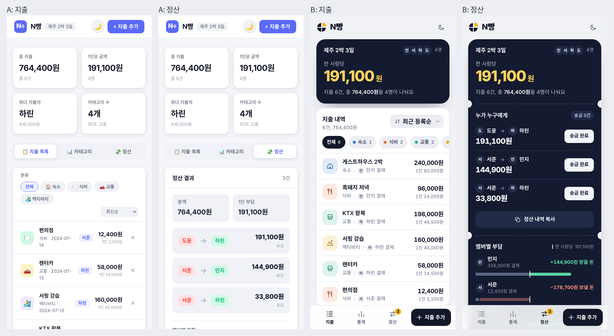

<!-- authoritative-lang: ko -->
<!-- 담당: 이서원. 집필 상태: 1차 초안 -->

# §5.1 작업에 맞는 모델 고르기 {#sec-model-selection .unnumbered}

앞선 장들에서는 AI 코딩 도구에 작업을 요청하는 방법과 이를 활용해 만들 수 있는 결과물을 살펴봤다. 실제로 도구를 열면 요청문을 쓰기 전에 어떤 모델과 설정으로 맡길지 정해야 한다. GitHub Copilot의 모델 비교 문서만 해도 작업별 추천 표에 스무 개가 넘는 모델을 싣고 있다. [GitHub Docs, AI model comparison](https://docs.github.com/en/copilot/reference/ai-models/model-comparison) (확인: 2026-11-20). 선택지가 많으면 가장 좋은 모델부터 찾게 되지만, 무엇을 맡길지 정해야 어느 모델이 좋은지도 판단할 수 있다.

여기서는 모델의 능력과 작업 적합성을 구분한다. 능력은 정해진 과제로 성능을 재는 시험인 벤치마크(benchmark)의 점수나 제공사가 설명하는 성능을 말한다. 작업 적합성은 필요한 결과를 감당할 수 있는 시간과 비용 안에 얻는지를 뜻한다. 이 구분은 설명을 위해 둔 것이다. 능력이 높다고 평가받는 모델도 내 작업에는 필요 이상으로 느리거나 비쌀 수 있다. 뒤의 실험에서도 가장 저렴한 모델이 작은 코드 수정 두 과제의 기준을 모두 통과했고, 차이는 시간과 비용에서 났다.

## 모든 작업에 같은 모델을 써야 할까?

친구 네 명이 여행 경비를 나누는 정산 앱 N빵을 만든다고 하자. 지출을 기록하고 항목별로 정렬한 뒤, 각자 보내고 받을 금액을 알려 주는 앱이다. 개발 중 AI에게 맡기는 일은 다음처럼 달라진다.

| 작업 | N빵에서 맡길 일 | 충분한 결과를 판단할 기준 |
| --- | --- | --- |
| 질문 | 지출 정렬 코드의 동작 설명 | 실제 코드를 따라가며 정렬 규칙과 예외 처리를 설명한다. |
| 코드 작성 | 항목별 정렬 함수 추가 | 정한 순서와 예외 처리를 지키고, 원래 목록을 바꾸지 않는다. |
| 디버깅 | 같은 지출이 두 번 저장되는 오류 수정 | 로그와 코드로 중복이 생기는 경로를 찾고, 정상적인 지출은 남기면서 원인을 고친다. |
| 리뷰 | 1인당 금액 계산 규칙 변경 검토 | 계산이 틀리는 위치와 조건, 근거를 구체적으로 짚는다. |

정렬 코드는 함수 하나를 읽고 설명할 수 있지만, 중복 저장의 원인은 화면에서 서버까지 흐름을 따라가야 찾을 수도 있다. 짧은 설명을 자주 주고받는 작업에서는 응답 속도가, 여러 파일을 연결해 원인을 찾는 작업에서는 분석이 충분한지가 중요하다. 먼저 작업마다 무엇을 만족해야 끝났다고 볼지, 즉 완료 기준을 적는다.

같은 코드 수정이라도 오류의 영향과 확인 방법이 다르다. 버튼 문구는 바로 보고 고칠 수 있지만, 잘못 계산한 정산 금액은 친구들의 송금액을 바꾼다. 영향이 크거나 확인이 어려울수록 사람이 검토할 범위도 함께 정한다. 앞 장의 산출물별 검수 기준처럼 모델을 고를 때의 기준도 작업에 따라 달라진다.

오류가 미치는 영향과 확인하기 쉬운지는 별개다. 정산 금액 계산은 틀리면 영향이 크지만, 예시 입력과 기대 결과를 자동으로 확인하는 테스트를 준비하면 오류를 찾기 쉽다. 화면 배치는 조금 어긋나도 영향이 작은 편이지만, 쓰기 편한지는 사람이 직접 보고 판단해야 한다. 뒤의 코드 수정과 화면 만들기는 이 차이를 살펴보기 위해 고른 작업이다.

## 모델 선택에서 무엇을 볼까?

먼저 모델과 도구가 필요한 입력과 기능을 지원하는지 확인한다. 화면을 보여 주며 질문하려면 이미지를 전달할 수 있어야 하고, 여러 파일을 고치려면 그 파일에 접근할 수 있어야 한다. 이 조건을 갖춘 후보를 정확도, 속도, 비용으로 비교한다.

정확도는 답변이 그럴듯한지가 아니라 완료 기준을 충족했는지로 판단한다. 정렬 기능이라면 항목 순서, 같은 항목 안의 금액 순서, 빈 목록 처리 등을 확인한다. 리뷰라면 “예외 처리를 보강하라”는 일반론보다 “10만 원을 세 명이 100원 단위로 올림해 나누면 합계가 100,200원이 된다”처럼 문제가 생기는 조건과 근거를 짚는 의견이 유용하다. 완료 기준 작성은 §6.1, 테스트로 확인하는 방법은 §10.1에서 다룬다.

속도는 첫 답변까지 걸린 시간과 검토 및 수정을 마칠 때까지의 시간을 나누어 본다. 첫 답이 빨라도 수정을 반복하면 전체 작업은 늦어진다. OpenAI의 모델 선택 안내도 결과를 확인하고 고치는 시간까지 포함해 쓸 만한 결과를 얼마나 빨리 얻는지 비교하라고 한다. [OpenAI, Model selection](https://developers.openai.com/codex/model-selection) (확인: 2026-11-20). 비용도 단가뿐 아니라 모델이 읽고 쓰는 양과 재요청 횟수까지 포함한다. 화면을 보며 바로 고치는 일인지, 하루에 수십 번 반복하는 일인지에 따라 속도와 비용의 우선순위가 달라진다.

일부 모델은 추론에 쓸 계산량을 조절할 수 있다. 이를 추론 강도(reasoning effort)라고 하며, 지원하는 단계와 기본값은 모델과 도구마다 다르다. Anthropic은 이 설정을 effort라고 부르며, 모델을 바꾸기보다 effort를 조정하는 편이 나을 때가 많다고 설명한다. 또 자신의 작업에 맞는 평가 과제로 결과를 확인하라고 안내한다. [Anthropic, Choosing the right model](https://platform.claude.com/docs/en/about-claude/models/choosing-a-model) (확인: 2026-11-20). 후보를 적을 때도 뒤의 표에 나오는 Haiku 5.5 / medium처럼 모델과 추론 강도를 함께 적는다.

프로그램에서 모델을 직접 호출하는 API는 보통 토큰 사용량에 따라 요금을 매긴다. 토큰은 모델이 글을 나누어 처리하는 단위다. 다음은 Claude API의 기본 가격 예다.

| 모델 | 입력 100만 토큰당 | 출력 100만 토큰당 |
| --- | --- | --- |
| Claude Haiku 5.5 | 0.10달러 | 0.50달러 |
| Claude Sonnet 5.5 | 2.00달러 | 10.00달러 |
| Claude Opus 5.5 | 4.00달러 | 20.00달러 |

출처: [Anthropic, Pricing](https://platform.claude.com/docs/en/about-claude/pricing) (확인: 2026-11-20; Claude API 기본 가격; 통화: USD). 캐시 읽기와 쓰기, 배치 할인 및 추가 옵션 요금은 제외했다. Haiku 5.5는 요청별 전체 입력이 100,000토큰 이하일 때의 단가이며, 이를 넘으면 입력 0.50달러, 출력 2.50달러다.

Opus 5.5의 단가는 Haiku 5.5의 40배지만, 작업당 비용도 40배인 것은 아니다. 같은 일을 끝내는 데 쓰는 토큰의 양이 모델과 설정에 따라 다르기 때문이다. 또 이 단가가 구독형 앱에서 작업 한 번에 내는 금액을 뜻하지도 않는다. 구독형 도구에서는 표시되는 사용량과 한도를 기준으로 비교하며, 과금 방식과 사용량 관리는 §5.5에서 다룬다. 작업 하나를 끝내는 데 걸릴 시간과 총비용은 단가표만으로 알 수 없다.

## 같은 작업, 다른 모델

실제 작업의 시간과 총비용을 살펴보려고 N빵의 코드 수정과 화면 만들기를 모델과 추론 강도를 바꿔 실행했다. 코드 수정은 준비한 테스트로, 화면 만들기는 결과물을 직접 열어 보며 판단했다. 결과는 이 과제와 조건에서 관찰한 것이며 모델의 일반적인 순위를 뜻하지 않는다.

### 코드 수정: 기준을 통과한 뒤의 차이

코드 수정은 두 과제다. 정렬 함수 추가에는 항목 순서와 금액 내림차순, 빈 목록 처리, 원래 목록 유지 등 완료 기준 다섯 개를 요청문에 적었다. 중복 기록 오류 수정에는 앱과 서버 코드, 저장소, 로그와 사용자 제보를 주고 원인을 찾아 고치게 했다. 로그에는 저장 응답이 3초 넘게 늦어지자 앱이 같은 요청을 다시 보낸 기록과, 저장 버튼이 0.08초 간격으로 두 번 눌린 기록이 있다. 제보에는 같은 금액의 커피를 따로 두 번 산 정상 기록도 있다. 그래서 재전송이나 두 번 누름에도 한 건만 저장하되, 새로 입력한 같은 내용의 지출은 남기는 것을 기준으로 정했다.

아래 표는 전체 실험 중 Claude Code의 네 설정을 추린 결과다. Claude Code는 Anthropic의 터미널용 코딩 도구다. 중간 대화 없이 요청 하나로 작업을 끝까지 실행했고, 실행 기록에 남은 API 단가 기준 추정 비용을 썼다. [Claude Code Docs, Run Claude Code programmatically](https://code.claude.com/docs/en/headless) (확인: 2026-11-20). 시작 코드와 요청문, 도구 환경을 같게 두고 설정마다 과제별로 세 번씩 실행했다. 매번 새 작업 폴더에서 시작했고 사람이 중간에 수정하지 않았다. 채점용 테스트는 정렬 과제에 다섯 개, 오류 수정 과제에 여덟 개로, 모델에게 보여 주지 않았다. 표에 실은 24회는 모두 채점용 테스트와 기존 테스트를 통과했다.

| 모델 / 추론 강도 | 정렬 시간 | 정렬 비용 | 오류 수정 시간 | 오류 수정 비용 |
| --- | --- | --- | --- | --- |
| Haiku 5.5 / medium | 17초 | 0.006 | 96초 | 0.025 |
| Sonnet 5.5 / low | 18초 | 0.080 | 36초 | 0.145 |
| Sonnet 5.5 / high | 21초 | 0.098 | 66초 | 0.212 |
| Opus 5.5 / medium | 29초 | 0.206 | 98초 | 0.488 |

설정: 표에 사용한 실행별 값 (실행: 2026-11-19; Claude Code 2.1.327; 모델 ID: claude-haiku-5-5, claude-sonnet-5-5, claude-opus-5-5; 요금제: Claude Max; Windows 11, Python 3.12.16, pytest 9.1.1; 설정별 과제별 3회). 시간은 실행 경과 시간의 중앙값으로 사람의 사후 검토를 제외했다. 비용은 도구가 기록한 API 기준 추정액의 평균(USD)이며, 구독 외에 청구된 금액이 아니다.

이번 실험에서는 모두 테스트를 통과했지만, 시간과 비용은 달랐다. 정렬 함수 추가는 Haiku로도 17초, 약 0.006달러에 끝났다. 중복 기록 수정에서도 Haiku의 비용이 가장 적었지만, 더 빨리 끝난 것은 Sonnet의 low였다. Sonnet을 high로 바꾸자 오류 수정 시간은 36초에서 66초로, 추정 비용은 0.145달러에서 0.212달러로 늘었고 테스트 통과 여부는 같았다.

실행 기록을 보면 Haiku는 더 많은 단계를 거쳤다. 턴은 모델이 한 번 응답하고 파일을 읽거나 고치는 한 단계다. 오류 수정에서 Haiku는 평균 18.7턴을 거쳤고 Sonnet의 low는 4턴에 끝냈다. Haiku가 읽고 쓴 토큰도 Opus의 약 두 배여서, 단가는 40배 차이지만 이 과제의 추정 비용은 약 20배 차이였다. 가장 비싼 Opus는 두 과제 모두 네 설정 가운데 가장 오래 걸렸다.

범위를 넓힌 실행에서도 모두 테스트를 통과했다. 같은 두 과제를 OpenAI의 코딩 도구 Codex CLI 0.170.0에서 GPT-5.6 Luna, GPT-6 Sol, GPT-6 Astra로 실행한 30회도 모두 통과했고, 두 과제 모두 중간 모델인 GPT-6 Sol의 low가 가장 빨랐다. 두 도구는 모델에 파일 접근과 명령 실행을 연결하는 방식이 달라 수치를 서로 비교하지 않았다. 오류 수정 요청문에서 완료 기준 목록을 빼고 증상만 알려 준 실행에서도 Claude Code의 네 설정은 세 번씩 모두 통과했다.

이번 과제에서 비용이 중요하다면 Haiku, 오류 수정의 대기 시간을 줄이고 싶다면 Sonnet의 low를 후보로 볼 수 있다. 다만 테스트 통과가 모든 입력의 정확도나 설명의 품질까지 보장하지는 않는다. 증상만 알려 준 실행에서 Sonnet high는 한 회의 정리 메시지에 약 1시간 36분 떨어진 두 로그를 5시간 가까이 떨어졌다고 적었고, Haiku는 한 회에서 한국어 요청에 영어로 답했다. 두 실행 모두 코드는 테스트를 통과했으므로 설명은 따로 확인해야 한다. 작은 코드베이스의 두 과제를 설정마다 세 번 실행한 관찰이어서, 더 큰 작업에서도 같은 결과가 난다고 일반화할 수는 없다.

### 화면 만들기: 사용 목적에 따라 달라지는 기준

앞의 비교에서는 준비한 테스트를 통과했는지가 기준이었다. 화면을 만들 때도 계산과 조작은 확인할 수 있지만, 어떤 정보를 먼저 보여 주는지와 사용하기 편한지는 결과물을 보며 판단해야 한다. 앞서 본 화면 배치처럼, 영향이 작아도 사람이 판단해야 하는 부분이 있다.

이를 살펴보려고 N빵의 정산 화면을 HTML 파일 하나로 만들어 달라는 같은 요청을 Claude 웹 앱의 새 채팅 두 곳에 넣었다. 지출 목록의 필터와 정렬, 지출 추가, 차트, 정산 결과, 다크 모드와 모바일 대응을 적고, 실제 서비스처럼 완성도 있는 화면을 요구했다. 샘플 지출 여섯 건을 주되 디자인은 지정하지 않았다. 한쪽(A)은 Sonnet 4.6의 낮음, 다른 쪽(B)은 Fable 5.2의 엑스트라를 골랐다. 낮음과 엑스트라는 앱의 추론 강도 단계다. 모델과 추론 강도를 함께 바꿔 한 번씩 실행했으므로 두 설정 조합을 비교하는 사례로 본다.

| 비교 항목 | Sonnet 4.6 / 낮음 | Fable 5.2 / 엑스트라 |
| --- | --- | --- |
| 기록한 생성 시간 | 약 2분 | 약 29분 |
| 기본 기능 점검 | 8개 항목 통과 | 8개 항목 통과 |

설정: N빵 HTML 화면 비교 기록 (실행: 2026-11-20; Claude 웹 앱, 앱 버전 미공개; 조합별 1회).

{fig-alt="A와 B 두 결과의 지출 화면과 정산 화면을 차례로 나란히 놓은 그림"}

기능 점검에는 샘플 총액 764,400원과 1인당 금액 191,100원, 정산 결과, 지출 추가에 따른 갱신, 필터와 정렬, 차트, 다크 모드, 모바일 표시의 여덟 항목을 썼다. 두 결과 모두 통과했다. 계산 결과와 화면 구성을 빠르게 확인하려는 목적이라면 약 2분 만에 받은 결과도 검토용 시안으로 삼을 수 있다.

정보 배치는 달랐다. A는 총 지출과 1인당 금액, 최다 지출자, 카테고리 수를 같은 크기의 카드 네 개로 두고, 정산 결과는 세 번째 탭에 넣었다. B는 1인당 금액을 가장 크게 보여 주고, 정산 화면에는 누가 누구에게 얼마를 보낼지와 함께 멤버별 결제액과 받을 돈, 보낼 돈을 실었다. 이처럼 기능이 같아도 사용자가 필요한 정보를 찾는 방식은 달라질 수 있다.

추가 점검 기록에는 처음 점검표에 없던 차이도 있다. 18,001원짜리 지출을 추가하자 A는 한 사람의 잔액과 송금액 합계가 1원 어긋났고, B는 남는 1원의 부담자를 표시했다. A는 항목명에 입력한 HTML 태그를 문자 대신 태그로 처리하기도 했다. 이런 차이는 첫 화면만 봐서는 알기 어렵다. 발견한 항목은 점검표에 더해 간다.

어느 설정을 쓸지는 화면의 용도에 따라 달라진다. 여러 배치를 빠르게 받아 보고 고르는 단계라면 짧은 시간에 얻은 시안이 유용하다. 다른 사람에게 계속 제공할 화면이라면 정보 배치와 금액 처리, 입력값, 모바일 조작까지 점검하고 고칠 시간을 잡아야 한다. 추가 시간과 비용을 들일지는 더 강한 설정이 기준을 얼마나 충족하고 수정할 일을 줄이는지 보고 정한다. 코드 수정에서 Sonnet의 추론 강도를 높였을 때는 시간과 비용만 늘었지만, 화면 만들기에서는 정보 배치와 금액 처리 같은 세부도 달랐다. 다만 한 번의 비교로 모델의 일반적인 우열이나 배포 적합성을 판단할 수는 없다.

## 후보를 좁히고 직접 비교하기

두 사례에서 보듯, 어떤 설정이 충분한지는 완료 기준과 시간, 비용의 우선순위에 따라 달라진다. 후보를 두세 개로 좁힐 때는 제공사의 모델 비교 문서를 참고할 수 있다. OpenAI의 모델 선택 안내는 모델과 추론 수준의 조합 여덟 가지에 각각 맞는 작업을 적고, 업무 유형 여섯 가지에 대한 모델별 적합도를 그림으로 보여 준다. 예를 들어 GPT-6 Luna의 낮음은 기대하는 결과가 분명할 때 파일을 조금 고치거나 필드를 뽑아내는 일에, GPT-6.2 Sol의 Medium은 기존 코드베이스의 버그 수정과 기능 추가에 맞는다고 안내한다. 같은 페이지는 이 적합도가 벤치마크와 독립적으로 실행한 예시 작업, 사용자 피드백을 바탕으로 한 대략적인 추정이라고 밝힌다. [OpenAI, Model selection](https://developers.openai.com/codex/model-selection) (확인: 2026-11-21).

{fig-alt="OpenAI 모델 선택 안내 화면. 왼쪽은 모델과 추론 수준별로 맞는 작업을 적은 목록, 오른쪽은 업무 유형 여섯 가지에 대한 모델 네 개의 적합도를 겹쳐 그린 방사형 그림"}

출처: [OpenAI, Model selection](https://developers.openai.com/codex/model-selection) (확인: 2026-11-21; 화면 캡처). 이 그림은 OpenAI의 자료이며, 이 책의 CC BY-SA 4.0 라이선스를 적용하지 않는다.

이런 안내와 벤치마크 점수는 후보를 좁히는 데 쓰되, 점수가 무엇을 재는지 확인한다. 코딩 벤치마크 SWE-bench Verified는 공개 저장소의 이슈를 고친 결과를 테스트 통과 여부로 채점하므로, 코드 설명이나 리뷰 의견의 품질은 재지 않는다. [OpenAI, Introducing SWE-bench Verified](https://openai.com/index/introducing-swe-bench-verified/) (게시: 2024-08-13; 수정: 2025-02-24). 이 벤치마크를 함께 만든 OpenAI도 2026년 2월, 자사 모델이 일관되게 풀지 못한 138개 과제를 검토해 그중 59.4%에서 테스트나 문제 설명의 결함을 확인했다며 점수 보고를 중단했다. [OpenAI, Why SWE-bench Verified no longer measures frontier coding capabilities](https://openai.com/index/why-we-no-longer-evaluate-swe-bench-verified/) (게시: 2026-02-23). 벤치마크의 한계는 §10.4에서 다룬다.

후보를 좁혔다면 내 작업을 직접 맡겨 보고 다음을 기록한다.

1. 맡길 일과 완료 기준을 정한다. 필요한 파일과 자료, 바꿔도 되는 범위를 적고, 테스트나 결과 점검표를 준비한다. 리뷰라면 문제의 위치와 발생 조건, 근거를 짚는지도 기준에 넣는다.
2. 같은 시작 파일과 요청문을 새 세션에 준다. 도구 환경을 고정하고 모델이나 추론 강도를 하나씩 바꾼다. 둘을 함께 바꿨다면 HTML 사례처럼 설정 조합의 비교로 기록한다. 반복할 작업은 같은 설정으로 몇 번 더 실행해 결과가 얼마나 달라지는지도 본다.
3. 기준 충족 여부와 실행 시간, 사람의 검토 및 수정 시간, 비용이나 사용량을 함께 본다. 날짜와 도구 버전, 모델 ID, 추론 강도도 남긴다. 필요한 기준을 충족한 후보 중에서 시간과 비용의 우선순위에 맞춰 고른다.

작고 확인하기 쉬운 일은 저렴한 모델이나 낮은 추론 강도로 시작해 부족하면 올려 볼 수 있다. 실패 뒤 수습이 어렵거나 난도가 불확실한 일은 강한 후보부터 시작하고, 기준을 유지하면서 설정을 낮춰 볼 수 있다. Anthropic도 이 두 출발점을 안내한다. [Anthropic, Choosing the right model](https://platform.claude.com/docs/en/about-claude/models/choosing-a-model) (확인: 2026-11-20). OpenAI는 같은 입력으로 비교해 품질 기준을 충족하는 가장 가벼운 설정을 유지하라고 한다. [OpenAI, Model selection](https://developers.openai.com/codex/model-selection) (확인: 2026-11-20). 앞의 코드 수정에서는 가장 저렴한 설정도 기준을 통과했으므로, 설정을 올릴지는 대기 시간을 보고 정하면 됐다.

기준에 못 미쳤다고 바로 모델을 바꿀 필요는 없다. 정렬 규칙을 다르게 이해했다면 예시 입력과 기대 결과를 보완하고, 관련 파일을 보지 못했다면 자료와 접근 권한부터 확인한다. 자료와 지시를 보완해도 같은 곳에서 실패하면 추론 강도나 모델을 조정한다. 남겨 둔 기준과 기록은 새 모델이 나왔을 때도 다시 쓸 수 있다. 다음 절에서는 모델이 한 번에 얼마나 많은 정보를 다룰 수 있는지, 컨텍스트 윈도를 살펴본다.

## 참고문헌

- [GitHub Docs, AI model comparison](https://docs.github.com/en/copilot/reference/ai-models/model-comparison) (확인: 2026-11-20). 추천 표의 모델 수를 확인했다. 추천은 GitHub Copilot이 제공하는 모델에 한정된다.
- [Anthropic, Choosing the right model](https://platform.claude.com/docs/en/about-claude/models/choosing-a-model), [Anthropic, Pricing](https://platform.claude.com/docs/en/about-claude/pricing) (확인: 2026-11-20). effort 조정과 두 출발점, Claude API 기본 가격을 확인했다.
- [OpenAI, Model selection](https://developers.openai.com/codex/model-selection) (확인: 2026-11-21). 같은 입력으로 비교하는 절차, 검토 시간을 포함한 시간 측정, 모델과 추론 수준별 안내와 모델별 강점 그림을 참고했다.
- [Claude Code Docs, Run Claude Code programmatically](https://code.claude.com/docs/en/headless) (확인: 2026-11-20). 비대화형 실행과 실행 기록의 비용 항목을 확인했다.
- [OpenAI, Introducing SWE-bench Verified](https://openai.com/index/introducing-swe-bench-verified/) (게시: 2024-08-13; 수정: 2025-02-24). 과제의 출처와 채점 방식을 확인했다.
- [OpenAI, Why SWE-bench Verified no longer measures frontier coding capabilities](https://openai.com/index/why-we-no-longer-evaluate-swe-bench-verified/) (게시: 2026-02-23). 벤치마크 과제의 결함에 관한 자료다.
