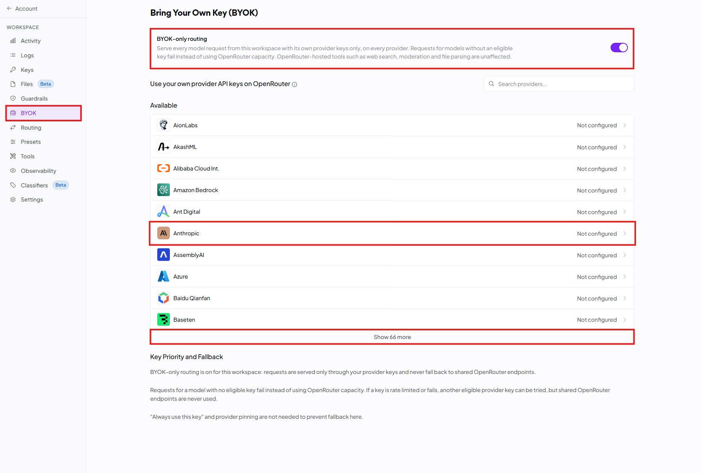
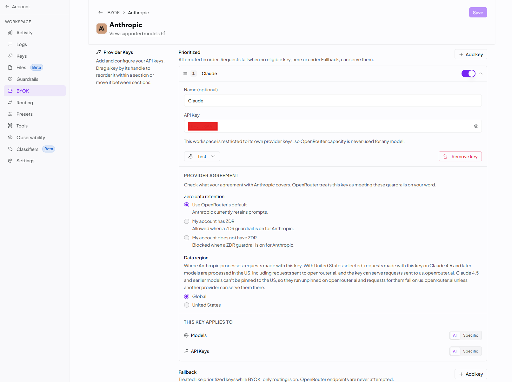

<!-- authoritative-lang: ko -->

# §5.4 모델 라우팅과 폴백 전략 {#sec-model-routing .unnumbered}

## 모델 라우팅은 무엇이며, 왜 필요한가?

여러분들이 인공지능(AI)을 활용하여 보고서를 작성하거나 소프트웨어를 개발하는 과정을 되돌아보며, 다음 두 가지 질문에 답해 보자.

* AI를 활용하는 과정에서 작업의 성격에 따라서 모델과 추론 수준을 다르게 설정하는가?
* 모든 요청을 고성능 프론티어 모델에 보낼 필요가 있을까?

이번 절에서는 위 두 가지 질문에 대한 하나의 접근으로 모델 라우팅에 대해서 알아본다.

보고서를 작성하는 과정 하나에서도 여러 가지의 하위 작업들이 존재하며, 해당 작업들이 요구하는 인지적인 노력의 양은 서로 상이하다. 보고서 작성을 위한 아이디어를 도출하고, 계획을 세우는 과정에서는 높은 수준의 인지적인 노력이 필요한 반면, 단순 오탈자를 수정하는 경우에는 큰 노력이 필요하지 않다. AI 역시 사람처럼 생각하고 판단할 수 있도록 만들어진 기술이기 때문에 수행하는 작업의 특성에 따라 요구되는 추론 수준이 상이하다.

많은 AI 기업들은 하나의 모델만 제공하는 것이 아니라 높은 성능을 보이는 모델부터 비교적 낮은 성능을 보이는 모델을 함께 제공하고 있으며, 모델별 적절한 작업이 무엇인지 제시하고 있다(본 장의 1절 참고). 예시로 OpenAI는 ‘OpenAI Developers’ 웹사이트를 통해서 프론티어 모델부터 하위 모델별로 적절한 작업이 무엇인지 사용자에게 안내하고 있으며, 사용자가 직접 작업 유형에 대한 정보를 제공하면 적절한 모델을 추천해주기도 한다.

 (확인: 2026-11-22)](images/05-4-model-routing/01-openai-model-selection.png){#fig-openai-model-selection fig-alt="OpenAI 개발자 문서의 모델 선택 화면. 작업 종류(Creating deliverables, Software engineering 등), 세부 작업, 지연 시간과 비용 대 출력 품질 사이의 우선순위를 고르면 오른쪽에 추천 모델 Luna와 추론 수준 Medium이 표시된다."}

사실 고성능을 보여주는 프론티어 모델과 저성능 모델의 비용과 속도가 동일하다면, 어떤 작업에 어떤 모델을 사용해야 하는가와 같은 고민을 할 필요가 없을 것이다. 하지만 본 장의 1절에서 살펴본 바와 같이 모델별 성능이 상이한 만큼 비용과 속도가 다르며, 프로젝트에 투입할 수 있는 시간과 비용의 자원의 양이 한정되어 있기 때문에 작업에 따라 적절한 모델을 활용할 필요가 있다.

만약 요청하고자 하는 작업의 특성에 따라서 사용자의 요청을 적절한 모델로 할당할 수 있는 방법이 있다면, 시간과 비용 측면에서 많은 이점을 가져갈 수 있을 것이다. 반면 그렇지 않을 경우 단순한 사용자의 요청이 높은 비용의 고성능 모델로 할당되어 불필요한 자원이 소모될 것이며, 복잡한 요청이 낮은 비용의 저성능 모델로 할당된 경우 작업을 처리하는 데 요구되는 수준이 모델의 역량을 초과하는 문제가 발생할 수 있다.

이러한 문제의식에서 출발하여 많은 관심을 받고 있는 것이 모델 라우팅(model routing)이다 [[1]](https://arxiv.org/abs/2603.04445). 모델 라우팅은 사용자의 요청을 처리하는 데 가장 적합한 모델을 선택하여 할당하는 방식을 의미한다. 어떤 모델에 작업을 할당해야 하는가에 대한 결정은 생성 전(pre-generation)과 생성 후(post-generation)에 이루어질 수 있다. 생성 전에 적합한 모델이 무엇인지 결정하는 경우 사용자의 입력을 바로 AI 모델이 처리하도록 하는 것이 아니라, 사용자의 입력과 질의의 특성에 기반해 가장 적합한 모델에 작업을 할당하는 방식이다. 생성 후에 적합한 모델이 무엇인지 결정하는 것은 캐스케이딩(Cascading)이라고 하며, 모델 라우팅을 설명할 때 함께 자주 등장하는 접근이다. 캐스케이딩은 먼저 작고 빠른 모델로 작업을 수행한 다음 품질 평가를 기반으로 초기 작업 결과가 불충분하다고 판단될 때 더 크고 복잡한 작업을 처리할 수 있는 모델로 순차적으로 상향 조정하여 작업을 처리하는 전략으로, 라우팅과 적절한 모델이 무엇인가에 관한 결정 시점이 다르지만 최적의 모델에 작업을 할당하고자 하는 동일한 목적을 가지고 있다. 생성 전과 생성 후의 두 가지 접근은 상호배타적인 것이 아니며, 두 가지 시점을 결합하여 사용할 수도 있다 [[1]](https://arxiv.org/abs/2603.04445).

## 모델 라우팅의 패러다임

먼저 모델 라우팅과 관련하여 Moslem과 Kelleher는 모델 라우팅 전략을 (1) 난이도 기반 라우팅, (2) 인간 선호 기반 라우팅, (3) 클러스터링 기반 라우팅, (4) 강화 학습 라우팅, (5) 불확실성 기반 라우팅, (6) 캐스케이딩이라는 6가지 유형의 패러다임으로 구분하였다 [[1]](https://arxiv.org/abs/2603.04445). 각 유형이 어떤 방식을 취하는지는 Moslem과 Kelleher의 문헌을 참고하라.

| 유형 | 설명 |
| :---- | :---- |
| 난이도 기반 라우팅 (Difficulty-aware routing) | 사용자 요청에 관한 복잡도를 추정하여 모델을 라우팅한다. |
| 인간 선호 기반 라우팅 (Human preference aligned routing) | 인간 피드백으로부터의 선호 데이터를 활용하여 모델을 라우팅한다. |
| 클러스터링 기반 라우팅 (Clustering-based routing) | 비지도 학습을 활용하여 사용자의 유사한 요청을 그룹화하여 모델을 라우팅한다. |
| 강화 학습 라우팅 (Reinforcement learning routing) | 정책 최적화(policy optimization), 밴딧(bandit methods) 방법을 포함하여 강화 학습을 활용하여 모델을 라우팅한다. |
| 불확실성 기반 라우팅 (Uncertainty-based routing) | 모델 신뢰도 추정치를 기반으로 모델을 라우팅한다. |
| 캐스케이딩 (Cascading) | 순차적인 다중 모델 접근 방식으로, 작고 빠른 모델에 작업을 할당한 후 품질 평가를 거쳐 크고 복잡한 작업을 처리할 수 있는 모델에 할당하는 방식으로 모델을 라우팅한다. |

이러한 6가지 유형들은 사용자의 작업에 적합한 모델을 할당하기 위한 접근들을 유형화한 것이다. 앞서 기술한 접근들은 적합한 AI 모델에 작업을 할당하기 위한 전략에 가까우며, 라우팅을 위해 따로 학습한 분류기나 규칙에 의존하는 경우가 많다 [[1]](https://arxiv.org/abs/2603.04445). 범용 AI 모델이 직접 작업을 계획하고 모델을 고르는 방식은 아니다. 그러나 최근 AI 기술의 발전으로 작업을 어떤 모델에 할당할 것인가에 관한 판단을 범용 AI 모델이 직접 수행하는 접근이 등장하고 있다. Shen 등은 AI 모델이 모든 작업을 직접 수행하는 것이 아니라, 작업을 계획하고 적절한 모델로 연결하는 역할을 수행할 수 있다는 가능성을 보여 주었으며 [[2]](https://arxiv.org/abs/2303.17580), 실제로 앞서 다룬 접근보다는 범용 AI 모델을 활용한 모델 라우팅 방식이 여러분들이 AI를 활용하여 작업을 수행하거나 소프트웨어를 개발할 때 유용할 수 있다.

## OpenRouter를 활용한 모델 라우팅 실습

앞서 기술한 내용을 토대로 모델 라우팅이 무엇인지는 알게 되었을 것이라고 생각한다. 다만 우리가 배운 지식을 실제 여러분들의 작업에 활용하기 위해서는 이러한 모델 라우팅을 어떻게 적용할 수 있는지 그 절차와 방법을 익힐 필요가 있다. 본 절에서는 다양한 AI 모델을 라우팅할 수 있도록 지원하는 OpenRouter를 활용하여 AI 모델이 요청 작업의 유형과 난이도 등을 분석하여 적합한 모델로 작업을 할당하는 Auto Router와 오류 발생 시 폴백(fallback)을 수행하는 방안에 대해 다룬다.

여러분이 이번 실습을 통해 해결해야 하는 문제 상황 시나리오는 다음과 같다.

::: {.callout-note title="시나리오"}
국내 온라인 유통 플랫폼 A는 고객 민원 처리에 발생하는 인건비 비용을 줄이고자 고객의 민원을 자동으로 처리하는 AI 모델을 개발하고 있다. 모든 민원 처리 요청을 프론티어 모델에 할당하기에는 비용 문제가 우려되어, 모델 라우팅을 통해 적절한 모델로 작업을 할당하는 방안을 모색 중이다.
:::

또한 실습에 활용되는 작업 환경과 준비물은 다음과 같다.

* Claude Code (본 실습은 유료 구독 환경에서 이루어진다.)
* Claude API (max와 ultra 요금제의 경우 월간 API 크레딧이 무료 제공된다.)
* OpenRouter API (본 실습을 위해서는 API 크레딧 충전이 필요하다.)

본 실습에서 Claude 구독과 API 키 발급과 관련된 내용은 다루지 않는다. 유튜브나 다른 참고 자료를 활용하고, 사용하고 있는 AI 서비스를 활용하여 절차와 방법을 확인할 수도 있다.

### BYOK 설정

본 실습의 목적은 OpenRouter를 활용하여 요청 작업을 적절한 AI 모델에게 할당하는 데 있다. 또한 이미 Claude를 유료로 구독하고 있고 API 크레딧을 보유하고 있으므로, OpenRouter가 Claude가 처리해야 할 작업까지 처리해서는 안 된다. 따라서 OpenRouter가 라우터와 추후 다룰 폴백 기능만 수행하고 작업은 Claude가 수행할 수 있도록 BYOK(Bring Your Own Key) 기능을 활용한다 [[4]](https://openrouter.ai/docs/guides/overview/auth/byok).

{#fig-openrouter-byok fig-alt="OpenRouter Workspace의 Bring Your Own Key (BYOK) 화면. 왼쪽 메뉴의 BYOK 항목, 상단의 BYOK-only routing 토글(켜짐), 제공업체 목록의 Anthropic 항목, 목록 아래의 Show 66 more 버튼이 빨간 상자로 강조되어 있다."}

먼저 OpenRouter(<https://openrouter.ai/>) 홈페이지에 접속하여 회원가입/로그인을 진행한다. (회원가입 과정에서 크레딧 충전이 가능하다.) 로그인 후 Workspace 화면의 왼쪽 메뉴에서 BYOK를 클릭한 후 BYOK-only routing을 활성화한다. 해당 기능은 사용자가 API 키를 등록한 AI 서비스 모델을 통해서만 작업을 처리하도록 제한하는 기능이다. 해당 기능을 활성화하지 않는 경우 OpenRouter의 크레딧이 소모된다 [[4]](https://openrouter.ai/docs/guides/overview/auth/byok).

{#fig-byok-key-settings fig-alt="OpenRouter BYOK의 Anthropic 키 등록 화면. Name 칸에는 Claude가 입력되어 있고 API Key 값은 가려져 있다. Zero data retention은 Use OpenRouter's default, Data region은 Global이 선택되어 있다."}

등록할 AI 서비스를 선택한 후에는 Name, API key를 입력하고 Zero data retention, Data region 등의 설정은 이미지와 같이 선택한다. 여기까지 완료했다면 기본적인 세팅은 완료되었다.

### Auto Router로 라우팅하기

| 구분 | 고객 요청 |
| :---- | :---- |
| 배송 현황 조회 | 고객의 택배가 지금 어디쯤 왔는지, 오늘 받을 수 있는지 조회 요청 |
| 배송지 변경 | 배송지를 변경하고 연락처도 새로운 번호로 수정 요청 |
| 택배 분실 사고 접수 | 이미 배송되었다고 앱에 표시되지만 수령하지 못했고 이번 달에만 두 번째라며 보상을 요구하며 분실 원인 규명이 필요 |

위와 같은 3건의 민원이 존재한다고 하였을 때, 모든 작업을 고성능 고비용의 프론티어 모델에 할당하는 것은 부적절해 보인다. 실제 인간이 작업을 처리하는 데 있어서도 단순히 배송 현황을 조회하는 것보다 택배 분실 사고가 접수되어 그 원인을 진단하는 것이 더 큰 인지적 노력이 필요하기 때문이다. 따라서 민원 요청에 따라서 적절한 AI 모델로 작업을 할당하는 모델 라우팅을 적용하면 성능과 비용의 트레이드 오프(Performance-Cost Trade-off)를 최적화할 수 있을 것이다.

모델 라우팅의 개념을 학습하면서, 사용자의 요청을 토대로 적절한 모델에 작업을 할당하는 구조를 배웠다. 이러한 과정을 OpenRouter는 Auto Router라는 기능을 통해 제공한다. Auto Router는 작업 요청이 들어왔을 때 빠른 결정 모델을 활용하여 요청을 평가한다 [[3]](https://openrouter.ai/docs/guides/routing/routers/auto-router).

과거에는 모델 라우팅을 하기 위해서 라우팅을 위한 코드를 인간이 작성해야 했다. 하지만 AI 기술이 발달함에 따라 AI가 계획을 수립하고 코드를 작성할 수 있게 되었으며, 이번 실습에서도 Claude Code를 활용하여 OpenRouter의 Auto Router 기능을 적용할 것이다. Claude Code를 실행하고, 다음과 같은 프롬프트를 입력한다.

```text
1) 배송 현황 조회 : 고객의 택배가 지금 어디쯤 왔는지, 오늘 받을 수 있는지 조회
2) 배송지 변경 : 배송지를 변경하고 연락처도 새로운 번호로 수정 요청하고 해당 수정 사항을 사내 배송 관리 시스템에도 적용해야 함
3) 택배 분실 사고 접수 : 이미 배송되었다고 앱에 표시되지만 수령하지 못했고 이번 달에만 두 번째라며 보상을 요구하며 분실 원인 규명이 필요함. 사내 물류 센터에서 택배 분류 과정에 문제가 없었는지 데이터 기반 검토가 필요하며, 관리자에게 알림을 보내고 배송 담당자에게 택배 분실 관련 면담을 진행해야 함

위의 민원 3건을 OpenRouter의 Auto Router로 처리하는 라우터를 만들어 줘.
모델을 직접 정하지 말고 모델 선택은 OpenRouter가 수행해야 해.
OpenRouter가 선택할 수 있는 모델은 anthropic/claude-haiku-5.5, anthropic/claude-sonnet-5.5, anthropic/claude-opus-5.5로 제한해줘.
각 민원을 어떤 AI 모델로 작업을 할당할 건지 알려줘.
```

프롬프트를 입력하면 OpenRouter의 Auto Router가 모델 라우팅 결과를 제공한다.

| 민원 | 선택된 모델 |
| :---- | :---- |
| 배송 현황 조회 | anthropic/claude-sonnet-5.5 |
| 배송지 변경 | anthropic/claude-sonnet-5.5 |
| 택배 분실 사고 접수 | anthropic/claude-opus-5.5 |

: Auto Router가 민원별로 선택한 모델 {#tbl-auto-router-result}

### 나만의 라우터 만들기

지금까지는 모델 선택을 OpenRouter의 Auto Router를 활용하여 빠른 결정 모델이 11가지 측면에서 사용자의 요청을 평가하고 라우팅 정책에 따라 모델을 선택하고 추론 수준을 결정하는 방식이었다 [[3]](https://openrouter.ai/docs/guides/routing/routers/auto-router). 이러한 Auto Router는 어떤 기준으로 해당 모델을 선택했는지는 보여주지 않는다. 이번 단계에서는 모델 선택에 관한 판단 기준을 사용자가 정하도록 해 보자.

```text
내가 정한 라우팅 기준을 토대로 모델 라우팅이 이루어지도록 하는 라우터를 만들어줘.
1) 배송 현황 조회  : anthropic/claude-sonnet-5.5 (추론 수준 low)
2) 배송지 변경 : anthropic/claude-haiku-5.5 (추론 수준 medium)
3) 택배 분실 사고 접수 : anthropic/claude-opus-5.5 (추론 수준 high)
4) 이미지 생성 : openai/gpt-5.4-image-2 (추론 수준 high)
```

프롬프트에 기술한 것처럼 판단 기준을 수립하고 이번 단계에서는 이미지 생성을 OpenAI의 모델로 할당하도록 하는 기준을 추가해 보겠다. Claude의 경우 이미지 생성 모델이 존재하지 않기 때문에(2026-11-22 기준), 이러한 접근은 높은 품질의 이미지를 생성하는 데 유용할 수 있다.

프롬프트를 입력하니 다음과 같은 출력 결과를 제공받았다.

| 민원 구분 | 분류 결과 | 모델 / 추론 수준 |
| :---- | :---- | :---- |
| 배송 현황 조회 | tracking | Claude Sonnet 5.5 / low |
| 배송지 변경 | address_change | Claude Haiku 5.5 / medium |
| 택배 분실 사고 접수 | lost_parcel | Claude Opus 5.5 / high |
| 이미지 생성 | image_generation | GPT-5.4 Image 2 / high |
| 분류 호출 4회 | | Claude Haiku 5.5 |

: 직접 정한 기준으로 만든 라우터의 실행 결과 {#tbl-custom-router-result}

기준표를 제공했을 때 배송 현황 조회는 Sonnet, 배송지 변경은 Haiku, 택배 분실 사고 접수는 Opus, 이미지 생성은 GPT-5.4 Image 2로 할당하는 결과를 확인할 수 있다. 이러한 방식을 활용하여 나만의 라우터를 만들 수 있다.

### 서버 오류에 대비한 폴백

하지만 이러한 라우터가 항상 약속한 결과를 반환해준다는 보장은 없다. AI 서비스를 제공하는 업체의 서버에 문제가 발생할 수 있으며, API 크레딧과 토큰 문제로 인해서 AI 모델 호출이 실패할 수 있다. 이 경우 민원 처리 시스템 전체가 중단될 수 있어 폴백 전략을 수립할 필요가 있다. 이 경우 간단히 다음과 같은 프롬프트를 입력하면 된다.

```text
혹시 모르는 문제 상황 발생을 대비하여, 기본적으로 내가 제공한  anthropic의 후보 모델로 할당하되, 서버 오류가 발생하였을 때는 아래와 같은 라우팅 기준을 적용해줘.
1) 배송 현황 조회  : openai/gpt-6-luna (추론 수준 low)
2) 배송지 변경 : openai/gpt-6.1-terra (추론 수준 medium)
3) 택배 분실 사고 접수 : openai/gpt-6.2-sol (추론 수준 high)
```

프롬프트 입력 후 서버 오류 상황에서 시뮬레이션한 결과 폴백 전략이 정상적으로 적용됨을 확인할 수 있다.

| 민원 구분 | 원래 모델 | 실제 응답 모델 | 추론 수준 |
| :---- | :---- | :---- | :---- |
| 배송 현황 조회 | Claude Sonnet 5.5 | GPT-6 Luna | low |
| 배송지 변경 | Claude Haiku 5.5 | GPT-6.1 Terra | medium |
| 택배 분실 사고 접수 | Claude Opus 5.5 | GPT-6.2 Sol | high |

: 서버 오류 시뮬레이션 결과 {#tbl-fallback-result}

## 참고문헌

- [1] [Yasmin Moslem, John D. Kelleher, Dynamic Model Routing and Cascading for Efficient LLM Inference: A Survey](https://openreview.net/forum?id=ypRg1TvQaM) (Transactions on Machine Learning Research, 2026; 프리프린트: <https://arxiv.org/abs/2603.04445>).
- [2] [Yongliang Shen 외, HuggingGPT: Solving AI Tasks with ChatGPT and its Friends in Hugging Face](https://proceedings.neurips.cc/paper_files/paper/2023/hash/77c33e6a367922d003ff102ffb92b658-Abstract-Conference.html) (NeurIPS 2023, 36권 38154–38180쪽; 프리프린트: <https://arxiv.org/abs/2303.17580>).
- [3] [OpenRouter, Auto Router](https://openrouter.ai/docs/guides/routing/routers/auto-router) (확인: 2026-11-22).
- [4] [OpenRouter, BYOK](https://openrouter.ai/docs/guides/overview/auth/byok) (확인: 2026-11-22).
